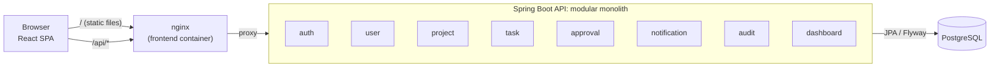
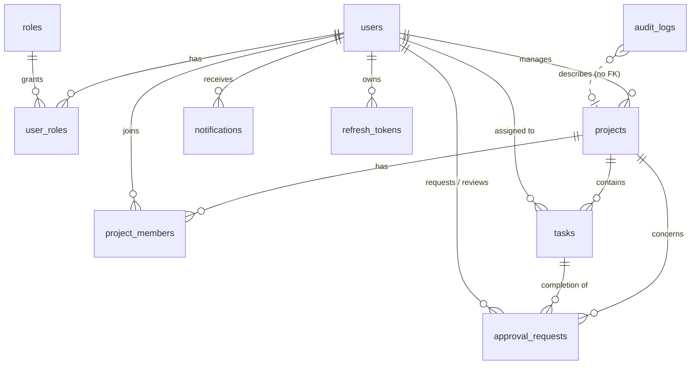

# EnterpriseFlow

**Project and workflow management for organizations:** projects, tasks with a defined workflow, two-person
approvals, project-level access control, an append-only audit trail and in-app notifications.


A **modular monolith** built with Java 21 / Spring Boot 3.5 on PostgreSQL, with a React / TypeScript single-page
application served through nginx.

> All demo data and accounts are fictional and exist only when the local demo profile is active.

---

## Table of contents

1. [Overview](#overview)
2. [Features](#features)
3. [Technology stack](#technology-stack)
4. [Getting started](#getting-started)
5. [Configuration](#configuration)
6. [Local development](#local-development)
7. [Testing](#testing)
8. [Architecture](#architecture)
9. [Security](#security)
10. [API](#api)
11. [Project structure](#project-structure)
12. [CI/CD](#cicd)
13. [Troubleshooting](#troubleshooting)
14. [Known limitations and roadmap](#known-limitations-and-roadmap)

Further documentation: [architecture](docs/architecture.md) · [database](docs/database.md) ·
[API reference](docs/api.md) · [security](docs/security.md) · [architecture decisions](docs/adr/)

---

## Overview

Organizations run many projects in parallel. Work is tracked in one tool, approvals happen over email, and
afterwards nobody can say who changed what. EnterpriseFlow brings projects, tasks and approvals into one place and
gives three guarantees:

1. **People only see and change what they are allowed to.** Enforced by the server, per project.
2. **Sensitive changes need a second person.** Task completion and budget changes go through approvals, and nobody
   can approve their own request.
3. **Every important action is traceable.** An append-only audit trail records who did what and when; the database
   itself rejects any attempt to modify it.

## Features

| Area | Highlights |
|------|-----------|
| Authentication | Login/logout, short-lived JWT access tokens, rotating refresh tokens in HttpOnly cookies with reuse detection, optional self-registration |
| Users | Admin user management, roles (ADMIN, MANAGER, EMPLOYEE), activation/deactivation, profile and password change |
| Projects | Create, edit, archive/restore, search, filter, paginate, members, manager assignment, progress derived from tasks |
| Tasks | Create, edit, assign to members, priorities, due dates, workflow state machine, filters, activity history |
| Approvals | Task completion and budget change requests, approve/reject with comments, self-approval prevention, concurrency-safe decisions |
| Dashboard | KPIs, tasks by status and priority, project progress, overdue tasks, pending approvals, recent activity, all scoped to the user |
| Notifications | Task assignment, approval requested/decided, membership added; unread badge, mark as read |
| Audit | Append-only log enforced by a database trigger, per-entity history, admin search |
| UI | Role-aware navigation, protected routes, dark mode, responsive layout |

## Technology stack

| Layer | Technologies |
|-------|-------------|
| Backend | Java 21, Spring Boot 3.5, Spring Web MVC, Spring Data JPA / Hibernate, Spring Security (OAuth2 resource server for JWT), Bean Validation, Actuator |
| Database | PostgreSQL 17, Flyway migrations, Hibernate schema validation (`ddl-auto=validate`) |
| API docs | springdoc-openapi (OpenAPI 3, Swagger UI) |
| Frontend | React 19, TypeScript (strict), Vite, React Router, TanStack Query, React Hook Form + Zod, Axios, Tailwind CSS, Radix UI, Recharts |
| Testing | JUnit 5, Mockito, Testcontainers, Spring MockMvc, Vitest, React Testing Library |
| DevOps | Docker multi-stage builds, Docker Compose, nginx, GitHub Actions |

---

## Getting started

The fastest way to run the whole application is Docker Compose. It needs **only Docker**: the backend and frontend
are compiled inside the images.

### Prerequisites

| Tool | Version | Needed for |
|------|---------|-----------|
| Docker Engine + Compose | 24+ / 2.24+ | Running the application (required) |
| Git Bash *(Windows only)* | any | Running `scripts/setup-env.sh` |
| JDK | 21 | Local backend development and tests |
| Maven | 3.9+ | Local backend development and tests |
| Node.js | 22 LTS | Local frontend development and tests |

<details>
<summary><b>Installing the prerequisites</b></summary>

**Windows** (PowerShell; restart after installing Docker Desktop, then start it once):

```powershell
winget install -e --id Docker.DockerDesktop
winget install -e --id EclipseAdoptium.Temurin.21.JDK
winget install -e --id OpenJS.NodeJS.22
```

Maven is not packaged in winget: download the binary zip from [maven.apache.org](https://maven.apache.org/download.cgi),
extract it and add its `bin` folder to `PATH`.

**Ubuntu / Debian:**

```bash
sudo apt update && sudo apt install -y openjdk-21-jdk maven
curl -fsSL https://deb.nodesource.com/setup_22.x | sudo -E bash - && sudo apt install -y nodejs
curl -fsSL https://get.docker.com | sudo sh && sudo usermod -aG docker "$USER"   # then log out and back in
```

**macOS** (Homebrew):

```bash
brew install --cask docker
brew install openjdk@21 maven node@22
```

</details>

### Run with Docker Compose

```bash
git clone <repository-url> enterpriseflow
cd enterpriseflow

./scripts/setup-env.sh        # creates .env with a random database password and JWT signing key
docker compose up --build     # the first build takes a few minutes
```

Once all three containers report `healthy` (`docker compose ps`):

| URL | Description |
|-----|-------------|
| http://localhost:3000 | Web application |
| http://localhost:8080/swagger-ui.html | Interactive API documentation |
| http://localhost:8080/actuator/health | Health check |
| `localhost:5433` | PostgreSQL, for psql or a database IDE |

### Demo accounts

The default `dev,demo` profile seeds fictional data into an empty database. Every account uses the password
**`Demo12345!`** (change it with `DEMO_PASSWORD` in `.env`).

| Email | Role | Good for trying |
|-------|------|-----------------|
| `admin@enterpriseflow.local` | ADMIN | User management, budget approvals, restoring archived projects |
| `maria.manager@enterpriseflow.local` | MANAGER | Managing "Customer Portal Redesign", approving task completion |
| `nikos.manager@enterpriseflow.local` | MANAGER | Managing "Data Platform Migration" |
| `eva.employee@enterpriseflow.local` | EMPLOYEE | Working on assigned tasks, requesting completion |
| `leo.employee@enterpriseflow.local` | EMPLOYEE | Member of two projects |
| `sofia.employee@enterpriseflow.local` | EMPLOYEE | QA tasks |

**Suggested walkthrough:** sign in as Eva, move a task to *In review* and request completion → sign in as Maria,
see the pending approval on the dashboard and approve it → the task is *Done*, Eva receives a notification and the
task history shows every step.

### Everyday commands

```bash
docker compose ps                  # container status
docker compose logs -f backend     # follow backend logs
docker compose down                # stop; data is kept
docker compose down -v             # stop and delete the database (demo data is re-seeded on next start)
docker compose up --build          # rebuild after code changes
```

---

## Configuration

All settings live in `.env`, created from [`.env.example`](.env.example) by `scripts/setup-env.sh`. The file is
git-ignored and must never be committed.

| Variable | Default | Description |
|----------|---------|-------------|
| `POSTGRES_DB`, `POSTGRES_USER` | `enterpriseflow` | Database name and user |
| `POSTGRES_PASSWORD` | *generated* | Database password |
| `JWT_SECRET` | *generated* | Base64 HMAC key (at least 256 bits) used to sign access tokens |
| `POSTGRES_HOST_PORT` | `5433` | Host port for PostgreSQL. Not 5432, to avoid clashing with a locally installed PostgreSQL |
| `BACKEND_PORT` | `8080` | Host port for the API and Swagger UI |
| `FRONTEND_PORT` | `3000` | Host port for the web application |
| `SPRING_PROFILES_ACTIVE` | `dev,demo` | `dev,demo`: Swagger UI, debug logging, demo data. `prod`: none of these |
| `DEMO_PASSWORD` | `Demo12345!` | Password of all demo accounts |
| `REGISTRATION_ENABLED` | `false` | Allow self-registration as EMPLOYEE |
| `REFRESH_COOKIE_SECURE` | `false` | `Secure` flag of the refresh cookie; always `true` behind HTTPS |
| `CORS_ALLOWED_ORIGINS` | `http://localhost:3000,...` | Origins allowed to call the API directly (not needed through the nginx proxy) |
| `BOOTSTRAP_ADMIN_EMAIL`, `BOOTSTRAP_ADMIN_PASSWORD` | *empty* | Creates the first administrator on a fresh, non-demo installation |

All published ports are bound to `127.0.0.1`, so nothing is reachable from other machines on the network.

**Production-like stack:** `docker compose -f docker-compose.yml -f docker-compose.prod.yml up -d` runs the `prod`
profile, publishes only the frontend and expects TLS to be terminated in front of it. See
[docs/security.md](docs/security.md#local-development-vs-production) for the full checklist.

---

## Local development

Run the database in Docker and the applications on the host, for fast reloads and debugging.

```bash
./scripts/setup-env.sh                 # once
docker compose up -d postgres          # database only, on localhost:5433
```

**Backend** on http://localhost:8080:

```bash
cd backend
set -a && source ../.env && set +a     # export .env into the shell (Git Bash / Linux / macOS)
mvn spring-boot:run
```

**Frontend** on http://localhost:5173, proxying `/api` to the backend:

```bash
cd frontend
npm ci
npm run dev
```

Set `VITE_BACKEND_URL` if the backend runs on a different address.

---

## Testing

```bash
# Backend: unit tests + integration tests against a real PostgreSQL (Testcontainers; Docker must be running)
cd backend && mvn verify

# Frontend: unit and component tests, plus the same static checks CI runs
cd frontend && npm test
cd frontend && npm run lint && npm run typecheck && npm run format:check && npm run build
```

| Suite | Scope |
|-------|-------|
| Backend (77 tests) | Task state machine, approval rules (self-approval, duplicate and **concurrent** decisions), admin lockout protection, authentication (expired, tampered and foreign-issuer tokens, refresh rotation and reuse detection, CSRF, deactivation, password change), project-level authorization (403 vs 404), database-level audit immutability, Flyway migrations, error handling |
| Frontend (17 tests) | Login flow, protected and role-aware navigation, filters, approval dialogs, API client error handling, error states |

---

## Architecture



- **One deployable application organized in feature modules** (`auth`, `user`, `project`, `task`, `approval`,
  `notification`, `audit`, `dashboard`), plus cross-cutting `security`, `config` and `common` packages.
- **Layering:** Controller → Service → Repository → Database. Controllers handle HTTP only, services own business
  rules and transactions, repositories own queries. Entities never leave the service layer; the API exposes DTOs
  (Java records).
- **Loose coupling between modules** through services and Spring application events. For example, deactivating a
  user publishes an event that the auth module uses to revoke the user's sessions.
- **Single origin:** the browser talks only to nginx (or the Vite dev server), which proxies `/api` to the backend,
  so no CORS is needed in normal use.

### Data model



Seven Flyway migrations in `backend/src/main/resources/db/migration`: UUID keys, foreign keys, unique and check
constraints, partial indexes and optimistic locking columns. Details in [docs/database.md](docs/database.md) and
the trade-offs in [docs/architecture.md](docs/architecture.md).

---

## Security

1. `POST /api/v1/auth/login` verifies the BCrypt hash and returns a **15-minute JWT** in the response body, plus a
   **refresh token** in an `HttpOnly; SameSite=Strict` cookie scoped to `/api/v1/auth`.
2. The SPA keeps the access token **in memory only** and sends it as `Authorization: Bearer …`.
3. On a 401 the SPA calls `POST /api/v1/auth/refresh` with a CSRF header. The refresh token is **rotated** on every
   use; presenting an already-used token revokes the whole token family.
4. **Layered authorization:** role checks (`@PreAuthorize`) for administrative endpoints and **project-level
   checks in the service layer** for everything inside a project. Projects the caller cannot access return 404, so
   their ids cannot be probed.
5. Errors follow RFC 9457 Problem Details and never expose internal messages or stack traces.

Threat model and production requirements: [docs/security.md](docs/security.md).

---

## API

Base path `/api/v1`. The complete, interactive reference is available in Swagger UI when the `dev` profile is
active; conventions, status codes and error formats are described in [docs/api.md](docs/api.md).

```bash
# Log in (stores the refresh cookie in cookies.txt)
curl -s -c cookies.txt -H 'Content-Type: application/json' \
  -d '{"email":"maria.manager@enterpriseflow.local","password":"Demo12345!"}' \
  http://localhost:8080/api/v1/auth/login | jq -r .accessToken > token.txt

# Projects visible to Maria
curl -s -H "Authorization: Bearer $(cat token.txt)" 'http://localhost:8080/api/v1/projects?size=5' | jq

# Overdue tasks across her projects
curl -s -H "Authorization: Bearer $(cat token.txt)" 'http://localhost:8080/api/v1/tasks?overdue=true' | jq
```

---

## Project structure

```text
.
├── backend/                     Spring Boot application
│   ├── src/main/java/com/enterpriseflow/
│   │   ├── auth/                login, JWT issuing, refresh-token rotation
│   │   ├── user/                users, roles, profile
│   │   ├── project/             projects, membership, project-level access
│   │   ├── task/                tasks and the workflow state machine
│   │   ├── approval/            approval requests and decisions
│   │   ├── notification/        in-app notifications
│   │   ├── audit/               append-only audit trail
│   │   ├── dashboard/           aggregated, user-scoped statistics
│   │   ├── security/ config/    Spring Security, CORS, OpenAPI, clock
│   │   ├── common/              base entity, errors, paging helpers
│   │   └── demo/                demo data seeder (demo profile only)
│   ├── src/main/resources/      application profiles and Flyway migrations
│   └── src/test/                unit and Testcontainers integration tests
├── frontend/                    React SPA
│   ├── src/app/                 routing, layout, providers
│   ├── src/features/            one folder per feature (pages, API hooks, tests)
│   ├── src/components/          shared UI components
│   ├── src/lib/                 API client, query setup, utilities
│   └── nginx.conf               static hosting and /api reverse proxy
├── docs/                        architecture, database, API, security, ADRs
├── scripts/setup-env.sh         generates .env with random secrets
├── docker-compose.yml           local / demo stack
├── docker-compose.prod.yml      production-like overrides
└── .github/workflows/ci.yml     CI pipeline
```

---

## CI/CD

[`.github/workflows/ci.yml`](.github/workflows/ci.yml) runs on every push to `main` and on every pull request:

1. **Backend:** Java 21, `mvn verify` (unit and Testcontainers tests); test reports are uploaded on failure.
2. **Frontend:** `npm ci`, lint, format check, type check, tests and production build.
3. **Docker:** builds both images once the two previous jobs pass.

The workflow runs with read-only permissions and needs no secrets.

---

## Troubleshooting

| Symptom | Cause and fix |
|---------|---------------|
| `ports are not available` / `bind: address already in use` | Another program uses the port. Change `FRONTEND_PORT`, `BACKEND_PORT` or `POSTGRES_HOST_PORT` in `.env` and run `docker compose up -d` again |
| `Set POSTGRES_PASSWORD in .env` | `.env` is missing. Run `./scripts/setup-env.sh` |
| Backend tests fail with `Could not find a valid Docker environment` | Testcontainers needs a running Docker daemon. Start Docker Desktop / the Docker service |
| `setup-env.sh: $'\r': command not found` | The script was checked out with Windows line endings. `.gitattributes` prevents this for new clones; in an existing clone run `sed -i 's/\r$//' scripts/setup-env.sh` |
| Login fails after changing `POSTGRES_PASSWORD` | The database volume keeps the original password. Run `docker compose down -v` to recreate it (this deletes the data) |
| The frontend shows old code after changes | Rebuild the images: `docker compose up --build` |

---

## Known limitations and roadmap

**Known limitations**

- Access tokens cannot be revoked before they expire (15 minutes). Deactivation and role changes take full effect
  at the next refresh; a token denylist or a shorter lifetime would close the gap.
- Several tabs refreshing at the same instant can trigger refresh-token reuse detection and sign the user out; a
  short grace period for the previous token is a common mitigation.
- Notifications are polled every 30 seconds rather than pushed.
- Sorting by priority is alphabetical, because enums are stored as text.
- No email delivery, file attachments or task comments.

**Roadmap**

- External identity provider (Keycloak / OIDC) with RS256 and JWKS instead of locally issued tokens.
- Server-Sent Events or WebSockets for live notifications.
- ArchUnit tests to enforce module boundaries in the build.
- Kubernetes manifests / Helm chart; metrics with Micrometer and Prometheus.
- Upgrade to Spring Boot 4.x (see [ADR 0002](docs/adr/0002-spring-boot-3-5.md)).
