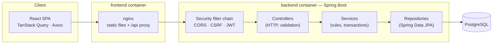

# Architecture

## Overview

EnterpriseFlow is a **modular monolith**: one Spring Boot application and one PostgreSQL database, organized
into feature modules with explicit boundaries. A React single-page application is served by nginx, which also
proxies API calls, so the browser only ever talks to one origin.

## Backend modules

| Package | Responsibility | Depends on |
|---------|----------------|-----------|
| `common` | Base entity, pagination DTO, error types, global exception handler, specification helpers | — |
| `config` | OpenAPI, CORS, clock, MVC argument resolvers | `security` |
| `security` | Filter chain, JWT encode/decode, `CurrentUser`, 401/403 responses | `user` (types) |
| `auth` | Login, refresh rotation, logout, CSRF endpoint, refresh-token storage | `user`, `security` |
| `user` | Users, roles, admin management, profile, admin bootstrap | `audit` |
| `project` | Projects, memberships, project-level authorization | `user`, `audit`, `notification` |
| `task` | Tasks, workflow state machine, filters | `project`, `user`, `audit`, `notification` |
| `approval` | Approval requests and decisions | `task`, `project`, `user`, `audit`, `notification` |
| `notification` | In-app notifications | — |
| `audit` | Append-only audit log and queries | `user` (names) |
| `dashboard` | Read model aggregating the modules above | `task`, `approval`, `audit` |
| `demo` | Seed data for the `demo` profile | services of all modules |

Cross-module side effects that would otherwise create cycles use **Spring application events**:

- `UserCredentialsInvalidatedEvent` (user → auth): revoke refresh tokens after deactivation, role change or
  password change.
- `ProjectMemberRemovedEvent` (project → task): unassign the removed member's open tasks.

Listeners are synchronous `@EventListener`s, so they run inside the publisher's transaction and commit or roll
back with it.

## Request lifecycle

Example: `PATCH /api/v1/tasks/{id}/status` by an employee.

1. **nginx** forwards `/api/...` to `backend:8080`.
2. **Security filter chain**: CORS check (no-op on same origin) → CSRF check (only for refresh/logout) →
   `BearerTokenAuthenticationFilter` validates the JWT signature, `exp` and `iss`, and maps the `roles` claim to
   `ROLE_*` authorities. Invalid or missing token → 401 Problem Details.
3. **DispatcherServlet** routes to `TaskController.changeStatus`. `CurrentUserArgumentResolver` builds the
   `CurrentUser` record from the token; `@Valid` validates the body (400 with field errors on failure).
4. **`TaskService.changeStatus`** (`@Transactional`) loads the task with its project, manager and assignee in one
   query (`@EntityGraph`), checks visibility (404 if not a member), checks permission (403 if neither assignee nor
   manager), and calls `task.changeStatus(...)`, where the **state machine** lives (409 on an invalid transition).
5. `AuditService.record` (propagation `MANDATORY`) writes the audit entry in the same transaction.
6. On return, the transaction commits: Hibernate flushes the dirty task with `WHERE version = ?` (optimistic
   lock; 409 if someone changed it meanwhile).
7. The controller returns a `TaskResponse` DTO that includes `allowedStatuses` for this caller.

## Design decisions

| Decision | Why | Trade-off |
|----------|-----|-----------|
| Modular monolith | One deployment and local transactions; module boundaries keep future extraction possible | Discipline needed to keep boundaries (ArchUnit planned) |
| DTOs as Java records, manual mapping | Explicit API contract, no reflection magic, entities never serialized | Some mapping code per module |
| Rich domain entities | Invariants (archived = read-only, state machine, manager is member) live next to the data | Entities are more than data holders; needs unit tests (present) |
| Flyway + `ddl-auto=validate` | Reviewed, versioned schema changes; startup fails if code and schema diverge | Every schema change is a new migration |
| `open-in-view: false` | Lazy loading can't leak into serialization; queries are explicit | Must fetch what responses need (entity graphs) |
| `@EntityGraph` for to-one, `@BatchSize` for collections | Avoids N+1 without in-memory pagination | Requires thought per query |
| Optimistic locking (`@Version`) | Lost updates and concurrent approvals become 409 instead of silent overwrites | Clients may need to retry |
| Database-backed notifications | Simple, transactional with the triggering change | Polling instead of push |
| Clock bean | Time-dependent logic (overdue, expiry) is testable | One more injected dependency |

## Frontend

- `src/app` — router, providers, layout (sidebar, top bar, breadcrumbs, notification bell, user menu, theme).
- `src/features/<feature>` — pages, dialogs and an `api.ts` with TanStack Query hooks per feature.
- `src/components` — shared UI primitives (shadcn/ui style on Radix) and app components (page header, empty /
  error / loading states, pagination, status badges).
- `src/lib/api-client.ts` — Axios instance, in-memory access token, single-flight refresh, error normalization.

Server state lives in TanStack Query; mutations invalidate hierarchical query keys (`['tasks']`, `['projects']`,
`['dashboard']`) so every affected view refreshes. Filters live in the URL query string, so views are shareable
and survive reloads. Permission-dependent UI uses flags computed by the server (`canManage`, `canEdit`,
`allowedStatuses`, `canDecide`) rather than re-implementing rules in the browser.
