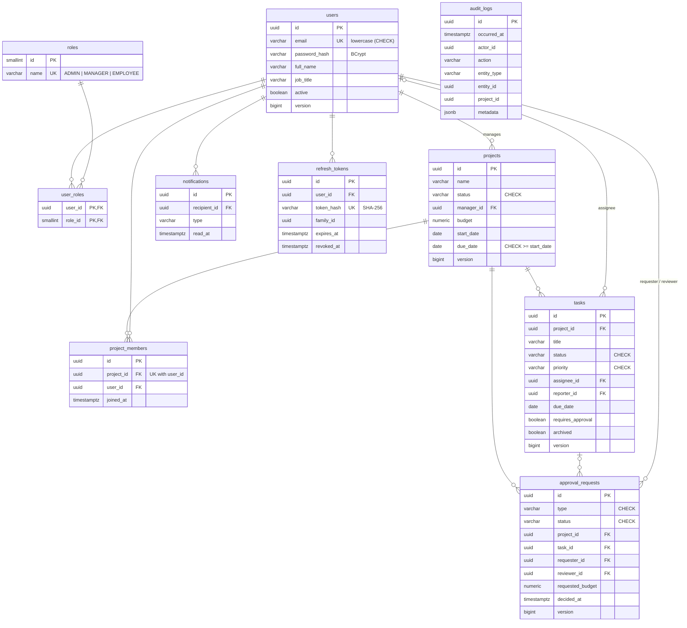

# Database

PostgreSQL 17, schema managed by Flyway (`backend/src/main/resources/db/migration`). Hibernate runs with
`ddl-auto=validate`: it never changes the schema, and the application refuses to start if entities and tables
disagree.

## Entity-relationship diagram

All tables also have `created_at` (and most `updated_at`) as `timestamptz`.

## Migrations

| Version | Content |
|---------|---------|
| V1 | `roles` (seeded with the three roles), `users`, `user_roles` |
| V2 | `projects`, `project_members` |
| V3 | `tasks` |
| V4 | `approval_requests` with payload/decision checks and a one-pending-per-target partial unique index |
| V5 | `notifications` |
| V6 | `audit_logs` and the append-only trigger |
| V7 | `refresh_tokens` |

## Design notes

**Identifiers.** UUIDs, generated by Hibernate before insert. They are not guessable or enumerable, and the id is
known before the row is written. `roles` uses small fixed ids because it is reference data referenced from code.

**Enums.** Stored as text (`@Enumerated(EnumType.STRING)`) with a matching `CHECK` constraint. Ordinal storage
would silently break when someone reorders the enum.

**Roles as a table.** A `user_roles` join table supports several roles per user and keeps roles queryable
(`countActiveAdmins`) — needed for the "at least one active admin" rule.

**`project_members` as an entity**, not a plain `@ManyToMany`: the membership has its own data (`joined_at`) and
a unique `(project_id, user_id)` constraint.

**Cascades and deletion.**

| Relationship | Behaviour | Reason |
|--------------|-----------|--------|
| project → members, tasks, approvals | `ON DELETE CASCADE` | They have no meaning without the project |
| user → roles, notifications, refresh tokens | `ON DELETE CASCADE` | Owned by the user |
| task/project → users | no cascade | Users are deactivated, never deleted, so history stays intact |
| audit_logs → anything | no foreign keys | The audit trail must outlive the rows it describes |

The application never hard-deletes projects or tasks: projects are archived, tasks are archived (soft delete).

**Integrity in the database, not only in code.**

- `ck_users_email_lowercase` backs up the application's email normalization (case-insensitive uniqueness).
- `ck_projects_dates`: due date not before start date.
- `ck_approvals_payload`: a task-completion request has a task and no budget; a budget request the opposite.
- `ck_approvals_decision`: approved/rejected requests always record reviewer and time.
- `uk_approvals_one_pending_per_target`: partial unique index — at most one pending request per task / project
  budget, even under concurrent submissions.
- `trg_audit_logs_immutable`: `UPDATE` and `DELETE` on `audit_logs` raise an error.

**Indexes** follow the queries: `(project_id, status)` for task boards, `assignee_id`, a partial index on open
tasks' `due_date` for the overdue query, `(recipient_id, created_at DESC)` plus a partial unread index for
notifications, `(entity_type, entity_id, occurred_at DESC)` for history views.

**Concurrency.** `version` columns on `users`, `projects`, `tasks` and `approval_requests` enable optimistic
locking. Two reviewers deciding the same request: the second commit fails the version check → HTTP 409.

## Avoiding N+1 queries

| Query | Technique |
|-------|-----------|
| Task and approval lists | `@EntityGraph` fetching project, manager, assignee, reporter (all to-one) with the page |
| Project list | Page with manager via entity graph + one grouped query for task counts + one for member counts |
| User list | `@BatchSize(100)` on roles: one extra query per page instead of one per user (a collection fetch join would paginate in memory, which `fail_on_pagination_over_collection_fetch` turns into an error) |
| Audit entries with actor names | One `findAllById` for all actor ids on the page |
| Dashboard | `COUNT` / `SUM(CASE …)` / `GROUP BY` in JPQL; no entities loaded for counting |
